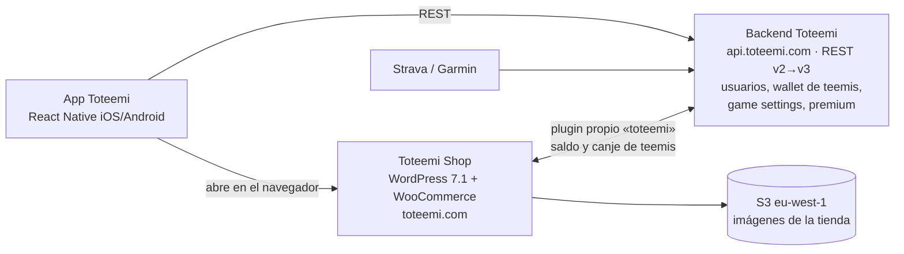

# 0. Situación actual y alcance

> Fuentes: repositorio de la app (`toteemi-app-upgrade`, rama develop) y revisión desde fuera de la tienda pública (`toteemi.com`, `staging-shop.toteemi.com`) el 23/10/2026. **No he tenido acceso al código de WordPress ni del backend**, así que lo que se dice de ellos sale de lo que se ve desde fuera y de lo que consume la app.

## El ecosistema Toteemi hoy

- **App** (este repo): gamificación de ciclismo y running. El usuario gana **teemis** con misiones, rankings, encuestas, invitaciones y un canje diario con límite (100 al día en estándar y 200 en Premium; los usuarios Premium ganan el doble).
- **Backend Toteemi** (`api.toteemi.com`): es **el dueño de la wallet**, con el saldo y el historial de transacciones. Entre los tipos de transacción hay tres que vienen de la tienda: `SPENT_STORE` (compra con teemis), `BOUGHT_STORE` (compra *de* teemis) y `REFUND`. En `envs/*.json` aparece como `BACKOFFICE_URL`, así que entiendo que **es el "backoffice propio"** del encargo.
- **Tienda**: `shop.toteemi.com` redirige a `toteemi.com`, que es a la vez **web corporativa y tienda**: WordPress 7.1.3 + WooCommerce sobre Apache, en AWS (detrás de un ELB y con las imágenes en S3).
- La app **no lleva la tienda dentro**: la pestaña *Shop*, los banners y el aviso que aparece después de reclamar teemis abren `STORE_URL` en el navegador. Premium se contrata y se gestiona en la tienda (`/hazte-premium/`, `/mi-cuenta/subscriptions/`).

## Qué hace hoy la tienda (WooCommerce)
| Funcionalidad | Cómo está hecha hoy |
|---|---|
| Catálogo | Equipamiento de ciclismo y running, nutrición, cosmética, **gift cards**, **inscripciones y experiencias**, **packs** y productos Premium |
| **Canje de teemis en el carrito** | **Plugin propio `toteemi`** (web components): un interruptor en el carrito que aplica los teemis ("Estás ahorrando X gracias a tus Teemis") |
| **Precio mínimo** | Componente `toteemi-min-price` en la ficha de producto |
| Precio en teemis | `teemis-price` muestra el precio y los teemis necesarios ("Loguéate para ver tu precio") |
| Productos especiales | Etiquetas `full-teemis-tag` (se puede pagar entero con teemis), `exclusive-teemis-tag` y productos que "solo se pueden pagar en euros" |
| **Precio y productos solo Premium** | `only-premium-price`, `premium-tag` y productos exclusivos para Premium |
| **Suscripción Premium** (mensual y anual) | Plugin **WooCommerce Subscriptions** |
| Códigos | **WC Serial Numbers** (probablemente para gift cards o inscripciones) |
| Packs | Easy Product Bundles |
| Envíos | Plugin APG de envío por peso y código postal; Premium no se vende en Ceuta y Melilla |
| Otros | Wishlist (TI), carrito lateral, WPForms, aviso de cookies |
| Cuenta | Iniciar sesión con la cuenta de Toteemi ("Regístrate y te damos 150 Teemis") |

**Problema que se ve desde fuera:** el carrito dice *"¿Has modificado el carrito? Recalcula tu ahorro aquí"*. El descuento por teemis **no se recalcula solo** cuando cambia el carrito. Es justo el punto débil que hay que resolver en la nueva plataforma (ver 1.6).

## Reparto de la investigación
| Plataforma | Responsable | Estado |
|---|---|---|
| Saleor | Alexander | ✅ Análisis + entorno local + revisión de la BD + pruebas de concepto |
| Medusa | Compañera | En curso |
| Shopify Plus | Sin asignar | Pendiente |

## Requisitos
### Del encargo
| # | Requisito | Detalle |
|---|---|---|
| R1 | Multipaís | 6 países europeos al arrancar (hoy solo España y EUR), con capacidad para crecer |
| R2 | Precio por país | Precio base propio en cada país |
| R3 | Precio mínimo por país | El que resulta de aplicar el **máximo de teemis** al precio base (ver más abajo) |
| R4 | Multitema | Catálogo distinto y tema visual propio en cada país |
| R5 | **Teemis → descuento en el checkout** | **Requisito crítico.** Si no se traduce en un descuento real en el checkout, la plataforma no sirve |
| R6 | Control total del checkout | Poder modificar el flujo y la lógica a fondo |
| R7 | Panel tipo CMS | Que alguien sin conocimientos técnicos gestione descuentos, precios y la operativa diaria |
| R8 | Integraciones | Backoffice/backend Toteemi, Stripe y Microsoft Dynamics 365 Business Central |
| R9 | Madurez | Que funcione desde el primer día, sin soluciones de nicho ni experimentales |

### Que salen de la tienda actual (no estaban en el encargo)
| # | Requisito | Por qué |
|---|---|---|
| R10 | **Suscripción Premium** recurrente (mensual y anual) | Hoy la cubre WooCommerce Subscriptions. Hay que **migrar las suscripciones activas** |
| R11 | **Precio y productos solo para Premium** | `only-premium-price` y productos exclusivos |
| R12 | Productos especiales | Gift cards, códigos (serials), inscripciones sin envío y packs |
| R13 | Movimientos de teemis desde la tienda | Comprar teemis (`BOUGHT_STORE`) y **devolverlos al reembolsar** (`REFUND`) |
| R14 | **Cuenta única Toteemi** | El cliente inicia sesión en la tienda con su cuenta de la app |
| R15 | Contenido web | `toteemi.com` también es la web corporativa (La App, Premium, Alma Toteemi, Empresas…). Si se deja WordPress, ese contenido necesita otro sitio |
| R16 | Envíos por peso y código postal | Incluida la exclusión de Ceuta y Melilla |

### Que salen de abrir varios países (detalle en el apartado 6)
| # | Requisito | Por qué |
|---|---|---|
| R17 | IVA del país del cliente (OSS) y **facturas legales** por país | Vender a particulares de otros países de la UE |
| R18 | Idiomas | Catálogo, tienda, emails y condiciones en el idioma de cada país (la app hoy solo está en español e inglés) |
| R19 | SEO y migración | Mantener el posicionamiento de `toteemi.com` (redirecciones 301) y migrar los datos de WooCommerce |

### Cómo funcionan los teemis (definición acordada)
Los **teemis** son la moneda del juego. Los gana el usuario en la app, viven en la **wallet del backend Toteemi** y se canjean en la tienda como descuento.

- Cada producto tiene, **en cada país**, un **máximo de teemis canjeables**.
- **Precio mínimo = precio base del país − (máximo de teemis × valor del teemi)**. Es lo menos que puede llegar a pagar un cliente por ese producto.
- Casos límite que ya existen hoy: productos que se pueden pagar **100 % con teemis** (precio mínimo 0 €) y productos que **solo se pagan en euros** (máximo de teemis 0).
- La plataforma tiene que poder: (1) consultar el saldo en el backend, (2) aplicar los teemis en el checkout respetando el máximo **y recalculando cuando cambie el carrito**, (3) cobrar en Stripe el total ya rebajado y (4) registrar el gasto en el backend (`SPENT_STORE`) y la devolución si hay reembolso (`REFUND`).

## Preguntas abiertas
1. ¿El "backoffice propio" del encargo es el backend Toteemi (`api.toteemi.com`)? Lo he asumido así.
2. ¿Hay acceso al código del plugin `toteemi` de WordPress? Ahí está la lógica actual de teemis, precio mínimo y Premium, y se podría reaprovechar.
3. ¿Con qué pasarela se cobran hoy las suscripciones Premium? Si ya es Stripe, migrarlas a Stripe Billing es mucho más fácil.
4. ¿La web corporativa se queda en WordPress (solo como CMS) o también se muda?
5. ¿Las empresas o clubes (`X-Company-Id` en la app) tienen precios o catálogo propios en la tienda?
