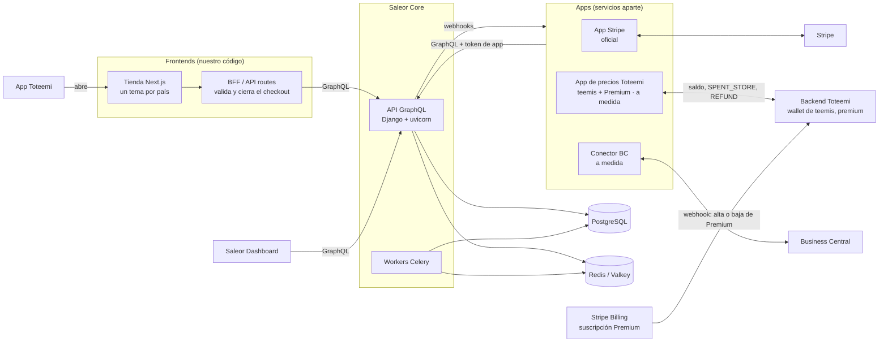
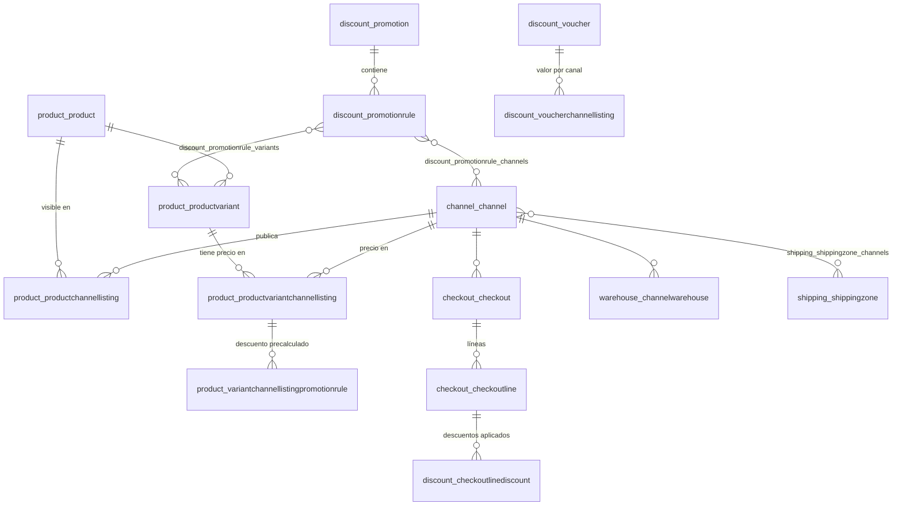
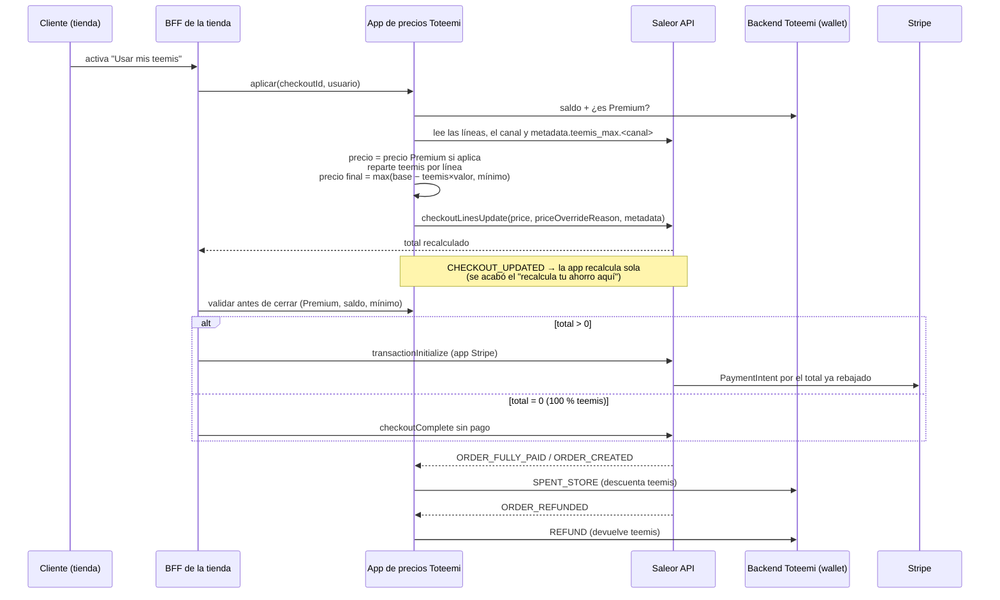

# 1. Saleor

> Datos revisados el **23/10/2026** sobre **Saleor 3.23** (última versión: 3.23.44, del 20/10/2026). Todo lo que pone *"verificado en local"* se ha comprobado en el entorno Docker de `saleor/`.

## 1.1 Resumen
Saleor es una **plataforma de e-commerce headless y open source** (licencia BSD-3) escrita en **Python/Django** que expone **toda su funcionalidad mediante una API GraphQL**. No trae tienda (frontend): la tienda y el checkout se programan aparte y hablan con la API. Su concepto central para vender en varios países son los **canales** (*channels*).

**Veredicto:** cumple de serie la parte estructural: multipaís, precios y catálogo por país, envíos por peso y código postal, gift cards, Stripe y control total del checkout.

**Los teemis son viables:** una app propia sobrescribe el precio de las líneas del checkout. Está **verificado en local**, incluido el caso de un producto pagado al 100 % con teemis (total 0 €).

Lo que **no trae y hay que cubrir aparte**:
- La **suscripción Premium**: no hay suscripciones en Saleor.
- Los **precios solo para Premium**: no hay grupos de clientes ni listas de precios.
- El conector con **Business Central**.
- El **inicio de sesión con la cuenta Toteemi**.
- La **web de contenidos**.

## 1.2 Licencia y precio
| Modalidad | Coste | Notas |
|---|---|---|
| **Open source (self-hosted)** | 0 € de licencia (BSD-3) | Pagamos la infraestructura (Postgres, Redis/Valkey, contenedores) y la operación. Hoy ya estáis en AWS |
| **Saleor Cloud – Sandboxes** | Gratis | Solo para pruebas |
| **Saleor Cloud – Select** | 1.599 $/mes | Hasta 200.000 $ de GMV al mes; por encima, 0,8 % del GMV |
| **Saleor Cloud – Volume** | 3.999 $/mes | Hasta 1.000.000 $ de GMV al mes; por encima, 0,4 % |
| **Saleor Cloud – Enterprise** | A negociar | Comisión desde el 0,2 % |

Opcionales de Cloud: *Accelerator* (6.000 $ en un pago, que se devuelven como crédito el primer año) y *Forward Deployed Engineering* (12.000 $, un mes de un ingeniero de Saleor). El código es **el mismo** en open source y en Cloud.

## 1.3 Arquitectura

### Externa: headless y "API-first"

- **Headless:** la tienda puede ser Next.js, Nuxt o lo que queramos. Saleor mantiene una tienda de referencia en Next.js que sirve de punto de partida. El **tema por país** vive aquí.
- **Extensión mediante "Apps", no plugins:** una app es un **servicio web independiente** (en cualquier lenguaje, aunque el SDK oficial es TypeScript) que se instala en Saleor, recibe un **token con permisos concretos** y se suscribe a **webhooks**. No se toca el core, así que **actualizar Saleor no rompe nuestras extensiones**. Es justo lo contrario que hoy con el plugin `toteemi` dentro de WordPress.
- **Las apps pueden incrustarse en el Dashboard** mediante iframes (páginas, pop-ups o widgets en la ficha de producto, pedido, cliente, voucher…). Así se le puede dar al equipo no técnico una pantalla de "teemis por país".

### Interna: monolito modular
- **Un monolito Django** organizado en módulos: `product`, `channel`, `discount`, `checkout`, `order`, `payment`, `warehouse`, `shipping`, `tax`, `giftcard`, `account`, `webhook`, `app`…
- **Piezas en ejecución** (verificado en local, `docker compose ps`):

| Servicio | Qué hace |
|---|---|
| `api` | Servidor GraphQL (ASGI/uvicorn), puerto 8000 |
| `worker` | Celery: tareas en segundo plano (recalcular precios con descuento, enviar webhooks asíncronos, emails, exportaciones) |
| `beat` | Planificador de Celery: lanza las tareas periódicas (por ejemplo, recalcular las promociones cada 30 s). **Debe haber uno solo** y tiene que arrancar con el planificador de Saleor (`--scheduler saleor.schedulers.schedulers.PersistentScheduler`); ver 1.7 |
| `db` | PostgreSQL |
| `cache` | Valkey/Redis: caché y *broker* de la cola de Celery |
| `dashboard` | Panel de administración (estáticos servidos con nginx), puerto 9000 |
| `jaeger` / `mailpit` | Solo en local: trazas OpenTelemetry y bandeja de emails de prueba |

- **Escalado horizontal:** `api` y `worker` no guardan estado, así que se pueden replicar detrás de un balanceador. Postgres admite **réplica de lectura** (`DATABASE_URL_REPLICA`).

### Webhooks: cómo se extiende la lógica
- **Asíncronos** (avisan de que algo ha pasado): `ORDER_CREATED`, `ORDER_FULLY_PAID`, `ORDER_REFUNDED`, `CHECKOUT_UPDATED`, `PRODUCT_UPDATED`… Son la base para registrar los teemis en el backend y para sincronizar con Business Central.
- **Síncronos** (Saleor espera la respuesta de la app). Verificado en local con introspección, en la 3.23 existen: cálculo de impuestos (`CHECKOUT_CALCULATE_TAXES`), métodos de envío (`SHIPPING_LIST_METHODS_FOR_CHECKOUT`, `CHECKOUT_FILTER_SHIPPING_METHODS`), pagos y transacciones (`TRANSACTION_*`, `PAYMENT_GATEWAY_INITIALIZE_SESSION`) y métodos de pago guardados.
- ⚠️ **No existe un webhook síncrono de "calcular descuentos"** ni de "validar el checkout antes de cerrarlo". Los descuentos propios se aplican por otra vía (ver 1.6).

## 1.4 Base de datos
- **Motor:** **PostgreSQL** (relacional). Verificado en local: **148 tablas**. El nombre de cada tabla indica a qué módulo pertenece: `product_*`, `discount_*`, `checkout_*`…
- Usa columnas `jsonb` en `metadata`/`private_metadata` de casi todas las entidades (canal, producto, variante, checkout, línea, usuario…). Ahí se pueden guardar datos propios sin tocar el esquema.

### Modelo multipaís, precios y descuentos (verificado en local)

| Concepto | Tabla(s) | Columnas clave |
|---|---|---|
| **Canal (≈ país o mercado)** | `channel_channel` | `slug`, `currency_code` (**una moneda por canal**), `default_country`, `metadata` |
| **Producto visible en un país** | `product_productchannellisting` | `channel_id`, `product_id`, `is_published`, `published_at`, `visible_in_listings` |
| **Precio por país** | `product_productvariantchannellisting` | `variant_id`, `channel_id`, `price_amount`, `cost_price_amount`, `prior_price_amount`, `discounted_price_amount`, `currency` |
| **Promociones automáticas** | `discount_promotion` → `discount_promotionrule` | `type` (catalogue/order), `catalogue_predicate` y `order_predicate` (**JSON**), `reward_value_type`, `reward_value` |
| **Vouchers (códigos)** | `discount_voucher`, `discount_vouchercode`, `discount_voucherchannellisting` | `discount_value` y `min_spent_amount` **por canal** |
| **Descuento aplicado a una línea** | `discount_checkoutlinediscount`, `discount_orderlinediscount` | `type`, `value`, `amount_value`, `promotion_rule_id`, `voucher_id`, `reason` |
| **Línea de checkout** | `checkout_checkoutline` | `price_override`, `price_override_reason`, `undiscounted_unit_price_amount`, `metadata` |
| **Stock por país** | `warehouse_warehouse`, `warehouse_stock`, `warehouse_channelwarehouse` | almacenes asignados a cada canal |
| **Envíos** | `shipping_shippingzone`, `shipping_shippingmethod`, `shipping_shippingmethodpostalcoderule` | tarifas por peso o por importe y **reglas de código postal** (por ejemplo, excluir Ceuta y Melilla) |
| **Impuestos por país** | `tax_taxconfiguration`, `tax_taxconfigurationpercountry`, `tax_taxclasscountryrate` | IVA por país y por clase de producto |
| **Gift cards** | `giftcard_giftcard` | `current_balance_amount`, `currency` |

**Cómo resuelve el multipaís:** un producto existe **una sola vez** (`product_product`). Su presencia en cada país es una fila en `*_channellisting`: si no hay fila para un canal, el producto no existe en ese país, y así se consigue un **catálogo distinto por país**. El precio también es una fila por variante y canal.

**Cómo resuelve los descuentos:** las promociones de catálogo (por ejemplo, el "¡Oferta!" que se ve hoy en la tienda) se **precalculan** (lo hace el worker) en `product_variantchannellistingpromotionrule` y `discounted_price_amount`. Las reglas se definen con un **predicado JSON** sobre producto, variante, categoría o colección (verificado por introspección), y el panel lo genera sin que nadie tenga que escribir JSON.

⚠️ **Lo que no existe en el esquema:**
- **No hay "precio mínimo" ni "máximo de teemis".** Y `product_productvariantchannellisting` **no tiene `metadata`**, así que el máximo de teemis por variante y país va en `product_productvariant.metadata` con una clave por canal (por ejemplo `teemis_max.es`) o en el backend Toteemi.
- **No hay grupos de clientes ni listas de precios.** Desde la 3.23 existen los *tipos de cliente* (`customerType`), pero solo clasifican al cliente: no los usan promociones, vouchers, canales ni catálogo (verificado). Las promociones no se pueden filtrar por tipo de cliente (verificado: los predicados solo aceptan producto, variante, categoría y colección). La propia documentación de Saleor dice que para precios por cliente hay que implementar "listas de precios" por nuestra cuenta.
- **No hay suscripciones** (el tipo `Subscription` del esquema GraphQL son las suscripciones a eventos de los webhooks, no pagos recurrentes).

### Escalado de 6 a N países
- **Un canal por país**: cada país nuevo es una fila en `channel_channel` más su configuración (almacenes, zonas de envío, impuestos y pasarela de pago para ese canal).
- **Crecimiento de datos:** las filas de precios crecen como `nº de variantes × nº de canales`. Con 5.000 variantes y 20 países salen 100.000 filas, que para Postgres es muy poco.
- **Lo que de verdad pesa** es la operativa: dar de alta precios y máximos de teemis en N canales y recalcular los descuentos precalculados. Saleor recomienda **Saleor Configurator** (configuración en YAML, como código) cuando hay muchos canales.
- ⚠️ **No modelar Premium como canales aparte** (`es` y `es-premium`): doblaría los canales (6 → 12, 20 → 40) y el cliente podría elegir el canal Premium desde la tienda. Premium va en la app de precios (ver 1.6).
- **Limitación:** una moneda por canal y sin conversión automática. Trivial en la eurozona; para PLN, SEK, CHF… hay que mantener sus precios aparte.

## 1.5 Requisitos, uno a uno
| Requisito | ¿Lo cumple? | Cómo |
|---|---|---|
| R1 Multipaís | ✅ De serie | Un canal por país |
| R2 Precio por país | ✅ De serie | `productvariantchannellisting.price_amount` |
| R3 Precio mínimo | 🟡 A medida, **verificado** | El máximo de teemis va en `metadata` y lo hace respetar la app de precios. El caso 100 % teemis (mínimo 0 €) funciona |
| R4a Catálogo por país | ✅ De serie | `productchannellisting` |
| R4b Tema visual por país | ✅ Por diseño (headless) | El tema vive en nuestra tienda; su configuración puede ir en `channel.metadata` |
| R5 Teemis → descuento en checkout | 🟡 A medida, **viable y verificado** | App con `HANDLE_CHECKOUTS` que sobrescribe el precio de la línea (ver 1.6) |
| R6 Control del checkout | ✅ Total | El checkout es una API |
| R7 Panel CMS | 🟡 Bueno, con matices | Ver 1.7 |
| R8 Integraciones | ✅ Stripe / 🟡 Backend Toteemi y BC a medida | Ver 1.8 |
| R9 Madurez | ✅ | 23,5k estrellas, releases semanales, línea 3.x estable |
| R10 Suscripción Premium | ❌ No nativo | **Stripe Billing** fuera de Saleor (ver 1.6) |
| R11 Precio y productos solo Premium | 🟡 A medida | Misma app de precios + atributo `premium_only` + control en el BFF |
| R12 Productos especiales | ✅ Gift cards e inscripciones / 🟡 serials y packs | Gift cards nativas; inscripciones = producto sin envío; serials y packs no son nativos (app o modelado propio) |
| R13 Comprar y devolver teemis | 🟡 A medida | Webhooks `ORDER_FULLY_PAID` y `ORDER_REFUNDED` → backend Toteemi |
| R14 Cuenta única Toteemi | 🟡 A medida | Plugin OpenID Connect de Saleor o BFF que intercambia el token de Toteemi *(por validar)* |
| R15 Contenido web | ❌ Fuera de alcance | Saleor no es un CMS: hace falta un CMS headless o mantener WordPress solo para contenido |
| R16 Envíos por peso y CP | ✅ De serie | Zonas de envío + tarifas por peso + reglas de código postal |

## 1.6 Checkout, teemis y Premium

### Qué trae de serie
| Mecanismo | Alcance | ¿Por canal? | ¿Sirve para los teemis? |
|---|---|---|---|
| **Promoción de catálogo** | Rebaja automática de productos, categorías o colecciones | ✅ (por regla) | ❌ Es igual para todos los clientes |
| **Promoción de pedido** | Rebaja al subtotal o regalo si se supera un importe | ✅ | ❌ No se combina con vouchers y no depende del cliente |
| **Voucher** | Código en el checkout (pedido, producto, envío) | ✅ (valor, mínimo y países) | 🟡 Solo como apaño: un voucher por cliente y pedido, y ocupa el único hueco de código promocional |
| **Gift card** | Saldo en una moneda que se aplica al total | Por moneda | 🟡 Sirve como monedero, pero **no permite un máximo por producto**, y además el saldo ya vive en el backend Toteemi |
| **Descuento manual** | Lo aplica el staff en pedidos borrador | — | ❌ No es autoservicio |
| **Precio sobrescrito por una app** (`price` en `CheckoutLineInput`) | Cambia el precio unitario de una línea | Implícito (el checkout pertenece a un canal) | ✅ **Este es el mecanismo** |

Reglas de combinación (según la documentación): de las promociones de catálogo solo se aplica la que más descuenta; las de pedido se calculan sobre el precio ya rebajado; un voucher **anula** las promociones de pedido; y el voucher o la promoción **se aplican después** del precio sobrescrito.

### Diseño propuesto: "App de precios Toteemi"
Una sola app que hace lo que hoy hace el plugin `toteemi` de WordPress: **teemis + precio Premium + precio mínimo**.

**Pruebas de concepto (verificadas en local):**
1. App con permiso `HANDLE_CHECKOUTS` + checkout con una variante de **45 $** → `checkoutLinesUpdate(price: 40, priceOverrideReason: "teemis: 5 canjeados")` → total **40 $**. ✅
2. La misma llamada con un token de **staff** (que no es app) se **rechaza**. ✅ Solo nuestra app puede cambiar precios, nunca el cliente desde la tienda.
3. **Producto pagado al 100 % con teemis:** precio sobrescrito a **0** → `chargeStatus: FULL` → `checkoutComplete` crea el pedido **sin pasar por el pago**. ✅

> 🔁 Estas pruebas, y el resto de afirmaciones marcadas como "verificado en local", se repiten con `python3 saleor/verificacion/verificar.py` (22 comprobaciones).

**Detalles a tener en cuenta:**
- **IVA:** el precio que fija la app se trata como si se hubiera introducido igual que el resto de precios del canal. En el canal de ejemplo (precios sin IVA), sobrescribir a 40 con una dirección en España da un total de **48,40** (21 % de IVA, verificado). Para Europa hay que configurar los canales con **precios con IVA incluido** (`tax_taxconfiguration.prices_entered_with_tax = true`), igual que muestra hoy la tienda ("IVA incl."). Así el precio mínimo y el ahorro en teemis que ve el cliente coinciden con lo que paga.
- El precio sobrescrito pasa a ser el **precio base** de la línea, así que en el pedido **no aparece como "descuento"**. La trazabilidad hay que llevarla en `price_override_reason` y en la `metadata` de la línea (por ejemplo `teemis_usados=5`).
- **Recalcular cuando cambia el checkout:** con el webhook `CHECKOUT_UPDATED` la app recalcula sola cuando cambian las cantidades, se añaden líneas o se aplica un voucher. Esto **arregla el problema actual** del carrito de WooCommerce. Como el webhook es asíncrono, el **BFF tiene que volver a validar justo antes de cerrar el checkout**.
- **Riesgo de saltarse el precio mínimo:** un voucher o una promoción se aplican **encima** del precio sobrescrito. La app debe descontarlos al calcular, o el negocio tiene que decidir que teemis y vouchers no se combinan.
- **Reservar el saldo:** entre aplicar los teemis y pagar, el saldo puede cambiar (por ejemplo, si caducan: `EXPIRED`). Hace falta reservar en el backend o volver a validar al cerrar.
- **Pedidos de 0 €:** no hay pago, pero hay que registrar igualmente el `SPENT_STORE`. La app debería escuchar `ORDER_CREATED` y comprobar el `chargeStatus`, en lugar de depender solo de `ORDER_FULLY_PAID` *(falta verificar qué eventos se disparan en un pedido de 0 €)*.

### Precio y productos solo para Premium
- **Precio Premium:** la misma app aplica el precio Premium (guardado en `metadata` de la variante por canal, o en el backend) cuando el backend confirma que el usuario es Premium. Así hay un solo punto que decide el precio.
- **Productos exclusivos:** atributo `premium_only`. La tienda los muestra u oculta y **el BFF bloquea el cierre del checkout** si un usuario no Premium los lleva. Saleor no puede limitar la visibilidad de un producto a un tipo de cliente.

### Suscripción Premium (mensual y anual)
Saleor **no tiene suscripciones**. La propuesta es sacar Premium del e-commerce:
- **Stripe Billing** (suscripciones y *Customer Portal* para gestionarlas) → webhook → el backend Toteemi activa o desactiva `is_premium`.
- En la app solo cambian `PREMIUM_UPGRADE_URL` y `PREMIUM_SUBSCRIPTION_DETAILS_URL`, que apuntarían a Stripe Checkout y Customer Portal.
- **Migrar las suscripciones activas de WooCommerce Subscriptions**: si hoy se cobran con Stripe, los métodos de pago ya están allí y la migración es sencilla. Si no, hay que pedir a los clientes que vuelvan a introducir la tarjeta. → **pregunta abierta**.

### Descuentos por país sin teemis
Para campañas normales por país (por ejemplo "Navidad FR −20 %"), las **promociones** y los **vouchers** son por canal y se gestionan desde el panel sin programar.

## 1.7 Panel de administración (Dashboard)
Qué ofrece: productos, variantes y atributos; precios y disponibilidad por país; promociones; vouchers; gift cards; pedidos, devoluciones y reembolsos (con Stripe); clientes; traducciones; y permisos por grupo **y por canal** (por ejemplo, que el equipo de Francia solo vea pedidos de Francia).

### Prueba real: la operativa de abrir un país nuevo (verificado en local)
He hecho desde el panel, con un navegador automatizado y sin usar la API, lo que haría alguien de operaciones al abrir España. Después he comprobado el resultado en la base de datos.

| Tarea | Cómo se hace | Valoración |
|---|---|---|
| **1. Crear el canal "España"** | *Configuration → Channels → Create*: nombre, slug y país. **Al elegir el país, rellena solo la moneda (EUR)** | ✅ Muy fácil (3 clics). Después aparece una **lista guiada** ("Finish setting up this channel"): almacén, envíos, pasarela de pago, productos e impuestos, con lo que falta para poder vender |
| **2. Poner un producto a la venta en España con su precio** | Ficha del producto → *Availability → Manage* → marcar España. Después, en *Variants → Bulk edit*, una **tabla tipo Excel con una columna por país** (Disponible y Precio): doble clic en la celda, escribir el precio e Intro | ✅ Cómodo para pocos productos; con cientos se hace largo (no hay importación CSV) |
| **3. Promoción "−20 % en camisetas" solo en España** | *Discounts → Promotions → Create* → *Add rule*: canal, porcentaje y condición "Products is Monospace Tee" | 🟡 Se entiende, pero **cada regla vale para un solo canal** (6 países = 6 reglas), los desplegables de la condición no tienen etiqueta y el valor por defecto es importe fijo (EUR), no porcentaje |

**Problemas encontrados en la prueba:**
- ⚠️ **Precio 0 € por defecto:** al marcar una variante como disponible en un país **sin escribir precio**, el panel la guarda **a 0,00 €** (verificado en la BD). Si además el producto está publicado, se vendería gratis. Hace falta una validación propia (por ejemplo, la app de precios avisa o bloquea los precios a 0 €) o una revisión antes de publicar.
- ⚠️ **La promoción tardaba en aplicarse:** el precio rebajado no cambiaba hasta reiniciar `beat`. **La causa era nuestra configuración:** beat usaba el planificador por defecto de Celery, que se queda bloqueado cuando una tarea con planificación propia de Saleor responde "todavía no" (lo explica `saleor/schedulers/schedulers.py`). Con `--scheduler saleor.schedulers.schedulers.PersistentScheduler`, la promoción se aplica en menos de 2 minutos (verificado en 8 de 9 ejecuciones; la primera tras el cambio falló sin explicación). El `docker-compose` oficial de `saleor-platform` tiene el mismo problema.
- ✅ **IVA:** los canales nuevos creados desde el panel se crean con **precios con IVA incluido** (`prices_entered_with_tax = true`, verificado), que es lo que necesitamos en Europa.
- ✅ **Idioma del panel:** viene en inglés, pero trae traducciones a español, francés, alemán, italiano, polaco y portugués (verificado en los ficheros del panel).
- La página de inicio sale vacía: las métricas de ventas necesitan instalar una app aparte ("Pulse").

**Valoración:** apto para que personal no técnico gestione el día a día (precios, disponibilidad por país, pedidos, campañas sencillas). Las cargas masivas y la configuración de un país nuevo de principio a fin (almacén, envíos, pagos, impuestos) piden algo de formación o de soporte técnico la primera vez.

**Carencias para nuestro caso:**
  - **No hay importación masiva de productos ni precios desde CSV** (solo exportación; verificado en local: solo existen `csv_exportfile`/`csv_exportevent`). Para la migración desde WooCommerce y la carga de 6 países hará falta un script, Configurator o una app.
  - **Los teemis y el precio Premium no aparecen en el panel** si no hacemos una extensión. Recomendación: un widget en la ficha de producto ("máximo de teemis y precio Premium por país") dentro de la app de precios.
  - No es un CMS de contenidos (páginas, banners, la web corporativa). Hay app oficial para conectar un CMS headless.

## 1.8 Integraciones
| Sistema | Tipo | Mecanismo | Notas |
|---|---|---|---|
| **Stripe (pagos)** | ✅ **Oficial** (repositorio `saleor/apps`) | App + Transactions API + webhooks de Stripe | Pago con captura diferida o inmediata; captura, cancelación y reembolso desde el panel; configuración por canal. Requiere Saleor 3.23. Limitaciones: no soporta Stripe Checkout (página alojada), solo una captura por autorización y la configuración no se puede editar (hay que recrearla) |
| **Stripe Billing (Premium)** | 🔧 Fuera de Saleor | Stripe Checkout + Customer Portal + webhooks → backend Toteemi | Sustituye a WooCommerce Subscriptions |
| **Backend Toteemi** (wallet, Premium) | 🔧 A medida | La app de precios llama a su REST (v3) y le envía `SPENT_STORE`, `BOUGHT_STORE` y `REFUND` a partir de los webhooks de Saleor | Hoy lo hace el plugin `toteemi` de WordPress: la lógica se puede portar |
| **Business Central** | 🔧 **A medida** | Webhooks de Saleor (pedidos, clientes) → conector → API REST/OData v2.0 de BC; en sentido contrario (stock, precios), webhooks o sondeo de BC → GraphQL de Saleor | **No existe conector oficial ni de la comunidad.** (BC sí trae conector nativo para Shopify, un dato relevante para la comparativa) |
| **Inicio de sesión Toteemi** | 🔧 A medida *(por validar)* | Plugin OpenID Connect de Saleor, o BFF que valida el token de Toteemi y opera con un token de app | Necesario para "Loguéate para ver tu precio" |

Otras apps oficiales en `saleor/apps`: AvaTax (impuestos), CMS, Klaviyo, Search (Algolia), Segment, Anonymizer, y SMTP y Products feed (estas dos, obsoletas; sus sustitutas se instalan desde el panel y Customer Emails solo funciona en Saleor Cloud).

## 1.9 Ecosistema y comunidad
| Indicador | Dato (23/10/2026) |
|---|---|
| Estrellas / forks en GitHub (core) | **23.466 / 6.156** |
| Último commit en `main` | 23/10/2026 (hoy) |
| Cadencia de releases | Varias por semana (parches y seguridad). Se mantienen **dos líneas** a la vez (3.22.x y 3.23.x) |
| Issues abiertos | ~300 |
| Dashboard | ~1.000 estrellas, activo |
| Apps oficiales | 9 en el monorepo `saleor/apps` (163 estrellas) |
| Empresa detrás | Saleor Commerce (vive de Saleor Cloud), con red de partners |

**Empresas que lo usan** (página oficial de casos de éxito): **Lush** (toda su tienda online global), **Breitling** (relojería, Suiza), **PCDIGA** (mayor tienda online de electrónica de Portugal), Kencove (B2B), Rough Trade, Pretty Green, myenergi… Del sector deportivo hay **Ale Bikewear** (ropa de ciclismo) y **Bikebiz**. Algunas (Butterfly Network, Seven Cells, TBD Health, Yuno) aparecen en la categoría "Subscriptions", lo que confirma que las suscripciones se montan con piezas externas encima de Saleor.

**Dónde está la comunidad:**
- **Discord** (saleor.io/discord): canal principal para preguntas y propuestas, con un *Community Update* mensual.
- **GitHub Issues:** solo para bugs; la documentación pide expresamente no usarlo para preguntas.
- **Stack Overflow:** etiqueta `saleor`.
- No hay un foro clásico. El soporte "con contrato" (canal de Slack dedicado y arquitecto asignado) solo viene con Saleor Cloud.

- **Comunidad más pequeña** que la de Shopify o WooCommerce: hay **pocas apps de terceros**. Cosas que hoy resuelve un plugin de WooCommerce (suscripciones, packs, serials, wishlist) aquí son **desarrollo propio o servicio externo**.
- A cambio, **hacer una app es sencillo** y está documentado (SDK de TypeScript, plantilla de app, App Bridge para el panel).
- No es de nicho ni experimental: la 3.x es estable desde hace años y la API está versionada, con avisos de *deprecation*.

## 1.10 De WooCommerce a Saleor: qué pasa con cada pieza
| Hoy (WooCommerce) | En Saleor | Esfuerzo |
|---|---|---|
| Catálogo, variantes, ofertas | Nativo (productos, variantes, promociones de catálogo) | Migración de datos |
| Plugin `toteemi`: canje en el carrito, precio mínimo, 100 % teemis, solo euros | **App de precios Toteemi** (precio sobrescrito + `metadata`) | Alto |
| `only-premium-price`, productos Premium | App de precios + atributo + BFF | Medio |
| WooCommerce Subscriptions (Premium) | **Stripe Billing** | Medio + migración |
| Gift cards | Nativo | Bajo |
| WC Serial Numbers | App propia (pool de códigos) o producto digital | Medio |
| Inscripciones y experiencias | Producto sin envío | Bajo |
| Easy Product Bundles (packs) | Producto propio con stock gestionado por una app, o pack como producto independiente | Medio |
| Wishlist, carrito lateral | En la tienda propia (wishlist en `user.metadata`) | Bajo |
| Envío por peso y CP (APG) | Nativo (zonas, tarifas por peso, reglas de CP) | Bajo |
| Web corporativa, WPForms, cookies | CMS headless, o WordPress solo como CMS | Medio |
| Inicio de sesión con la cuenta Toteemi | OIDC o BFF | Medio |

## 1.11 Puntos fuertes, débiles y riesgos
**Puntos fuertes**
- Multipaís, precio por país y catálogo por país **nativos y bien modelados** en la base de datos.
- **Control total del checkout** y mecanismo oficial para precios a medida desde una app. Permite arreglar el "recalcula tu ahorro" actual.
- Extensión mediante apps desacopladas: **actualizar no rompe nada**, al contrario que con los plugins de WordPress.
- Open source BSD-3: sin dependencia del proveedor y con la opción de Cloud gestionado.
- Stripe oficial; gift cards y envíos por código postal nativos; permisos por canal en el panel.

**Puntos débiles**
- **Hay que construir la tienda y el checkout** (es headless): mucho más trabajo inicial que con una plataforma con temas.
- **No tiene suscripciones, grupos de clientes ni listas de precios**: Premium hay que resolverlo fuera.
- **Teemis, precio mínimo, Premium, Business Central e inicio de sesión: desarrollo a medida.**
- Ecosistema de apps pequeño: muchas cosas que hoy son un plugin aquí son desarrollo propio.
- No importa CSV en el panel. No hay webhook síncrono de descuentos ni de validación.

**Riesgos**
| Riesgo | Impacto | Mitigación |
|---|---|---|
| El precio mínimo se rompe al combinar teemis con vouchers o promociones | Alto | La app los descuenta al calcular y el BFF valida al cerrar, o se prohíbe por negocio combinarlos |
| Migración de las suscripciones Premium activas | Alto | Si hoy se cobran con Stripe, se migran a Stripe Billing con los mismos métodos de pago |
| Coste de desarrollar la tienda, el checkout, la app de precios, el conector de BC y el inicio de sesión | Alto | Partir de la tienda de referencia y del SDK de apps; portar la lógica del plugin `toteemi`; valorar el *Forward Deployed Engineering* de Saleor |
| Saldo de teemis inconsistente entre aplicar y pagar | Medio | Reservar en el backend Toteemi y volver a validar al cerrar |
| La web corporativa se queda sin sitio al dejar WordPress | Medio | Decidir CMS (WordPress headless o un CMS headless) |
| Operación propia (self-hosted) | Medio | Saleor Cloud, o infraestructura gestionada en AWS (RDS y ElastiCache) |
| Las promociones no se aplican por usar el planificador por defecto de beat | Medio | Arrancar beat con `--scheduler saleor.schedulers.schedulers.PersistentScheduler` y alertar si los precios rebajados no se recalculan; con Saleor Cloud lo opera Saleor |
| Productos publicados a 0 € por despiste en el panel | Medio | Validación en la app de precios y revisión antes de publicar |
| Facturas legales por país | Medio | Que las emita Business Central y se enlacen al pedido en Saleor (`invoice.external_url`); ver el apartado 6 |

## Fuentes
- [Saleor – GitHub](https://github.com/saleor/saleor) · [Releases](https://github.com/saleor/saleor/releases) · [saleor-platform (Docker)](https://github.com/saleor/saleor-platform) · [Apps oficiales](https://github.com/saleor/apps)
- [Precios de Saleor Cloud](https://saleor.io/pricing)
- [Docs: Canales](https://docs.saleor.io/developer/channels/overview) · [Descuentos](https://docs.saleor.io/developer/discounts/overview) · [Promociones](https://docs.saleor.io/developer/discounts/promotions) · [Gift cards](https://docs.saleor.io/developer/gift-cards)
- [Docs: Líneas de checkout y precio a medida](https://docs.saleor.io/docs/3.x/developer/checkout/lines) · [CheckoutLineInput](https://docs.saleor.io/api-reference/checkout/inputs/checkout-line-input)
- [Docs: Webhooks síncronos](https://docs.saleor.io/developer/extending/webhooks/synchronous-events/overview) · [Extender el Dashboard con apps](https://docs.saleor.io/developer/extending/apps/extending-dashboard-with-apps)
- [Docs: App de Stripe](https://docs.saleor.io/developer/app-store/apps/stripe/overview)
- [Saleor limitations (Swell, competidor: tomarlo con cautela)](https://www.swell.is/content/saleor-limitations)
- [Casos de éxito de Saleor](https://saleor.io/case-study) · [Soporte y comunidad](https://docs.saleor.io/developer/community/support) · [Eliminación de la app de facturas](https://github.com/saleor/apps/pull/1496) · [Cálculo de precios e impuestos](https://docs.saleor.io/developer/price-calculation)
- [Business Central – visión general de integraciones](https://learn.microsoft.com/en-us/dynamics365/business-central/dev-itpro/developer/integration-overview)
- Repositorio de la app Toteemi (`docs/teemis.md`, `docs/modules/wallet.md`, `envs/*.json`) y tienda pública `toteemi.com`
